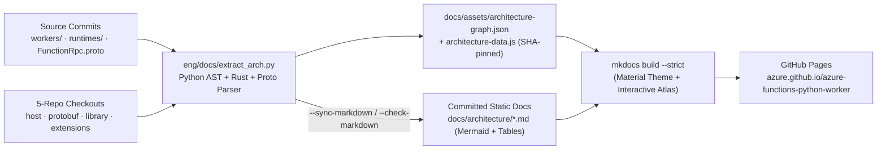

# Commit Auto-Sync Pipeline

This documentation site uses a **hybrid MkDocs Material + Deterministic Code-Graph** architecture so that **both** human-readable static Markdown in Git and the interactive Architecture Explorer stay accurate as the codebase evolves.



---

## How Static Markdown & Interactive Diagrams Coexist

1. **Committed Markdown as Durable Source (`docs/**/*.md`)**:
   - Architectural motivation, rationale, and design trade-offs are authored directly in standard Markdown files under `docs/architecture/`.
   - Bounded `<!-- BEGIN AUTO-GENERATED: <id> -->` ... `<!-- END AUTO-GENERATED: <id> -->` sections embed deterministic `mermaid` topology/sequence diagrams and component tables directly into the `.md` files—so browsing `docs/` in GitHub, grepping locally, or reviewing PR diffs always shows complete static diagrams without needing JavaScript.
2. **Interactive Explorer Enhancement (`docs/assets/atlas-embed.js`)**:
   - On GitHub Pages (and `mkdocs serve`), `<div class="arch-atlas-mount" data-era="..."></div>` mounts the interactive compound swimlane canvas, 7-phase lifecycle stepper, hop-by-hop packet trace, and live AST/Rust symbol inspector backed by `architecture-data.js`.
3. **CI Drift Verification (`.github/workflows/architecture-pages.yml`)**:
   - Runs `python3 -m unittest discover -s eng/docs/tests -v` (verifying referential integrity, Rust/Python symbol extraction, and `--check-markdown` sync).
   - Checks out sibling repositories (`azure-functions-host`, `azure-functions-language-worker-protobuf`, `azure-functions-python-library`, `azure-functions-python-extensions`) to enrich cross-repo symbol anchors.
   - Runs `mkdocs build --strict` and deploys to GitHub Pages on `dev`.

---

## Local Authoring & Preview Commands

```bash
# 1. Refresh generated graph + sync bounded Mermaid/table sections in docs/**/*.md
python3 eng/docs/extract_arch.py --sync-markdown

# 2. Run extractor & Markdown drift unit tests
python3 -m unittest discover -s eng/docs/tests -v

# 3. Preview locally with MkDocs Material live-reload
pip install -r eng/docs/requirements.txt
mkdocs serve -a 127.0.0.1:8765
```

---

## Live Scanned Subsystem Inventory

<!-- BEGIN AUTO-GENERATED: package-inventory -->
| Subsystem | Tracked Source Files | Total Lines (LOC) | Representative Entry |
| --- | --- | --- | --- |
| `azure_functions_worker` | 37 | 5,618 | `workers/azure_functions_worker/__init__.py` |
| `proxy_worker` | 10 | 1,425 | `workers/proxy_worker/__init__.py` |
| `r2p2_rust` | 7 | 3,257 | `workers/r2p2/src/bridge.rs` |
| `r2p2_bridge` | 2 | 1,644 | `workers/r2p2/bridge/bridge.py` |
| `runtime_v2` | 28 | 3,797 | `runtimes/v2/azure_functions_runtime/__init__.py` |
| `runtime_v1` | 27 | 2,980 | `runtimes/v1/azure_functions_runtime_v1/__init__.py` |
<!-- END AUTO-GENERATED: package-inventory -->
