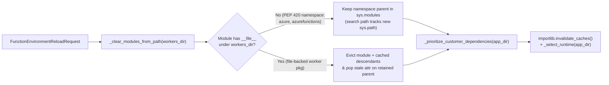

# Dependency Isolation & Placeholder Specialization

In Linux Consumption and Flex Consumption, warm standby ("placeholder") containers boot the worker process **before** any customer function app or `.python_packages` directory is mounted. When a container is specialized to a customer site via `FunctionEnvironmentReloadRequest` (or during `WorkerInitRequest` on Dedicated/Premium plans), the worker must promote customer dependencies ahead of bundled worker packages.

---

## `sys.path` Search Priority After Specialization

Across both `proxy_worker` (`3.13–3.14`) and `r2p2` (`3.15+`), specialized `sys.path` ordering guarantees customer-pinned packages take precedence:

```text
1. Customer packages        (<app_dir>/.python_packages/lib/site-packages)
2. Bundled worker runtime   (workers_dir — fallback azure_functions_runtime v2/v1)
3. Customer app directory   (function_app_directory — function_app.py & user modules)
```

---

## Evolution of Isolation Across Worker Generations

### Python ≤ 3.14 (`DependencyManager`)
In `workers/azure_functions_worker/utils/dependency.py` and `workers/proxy_worker/utils/dependency.py`:

1. **Cold Placeholder Boot (`use_worker_dependencies`)**: Forces worker dependencies first on `sys.path` so `grpcio` and `google.protobuf` C-extensions load from the worker's verified bundle rather than unverified paths.
2. **Specialization (`prioritize_customer_dependencies`)**: Reorders `sys.path` so customer `.python_packages` come first and clears previously imported worker copies of customer-overridable libraries.
3. **Structural Limitation**: Because `google.protobuf` uses a process-global C descriptor pool (`upb` / C++ extension), loading `protobuf` in the worker process at boot could still clash with incompatible `protobuf` versions pinned by customer apps.

### Python 3.15+ R2P2 (`bridge.py` + Namespace-Safe Eviction)
R2P2 eliminates transport collisions completely and hardens `sys.modules` eviction in [`workers/r2p2/bridge/bridge.py`](https://github.com/Azure/azure-functions-python-worker/blob/dev/workers/r2p2/bridge/bridge.py):

1. **Zero Transport Pollution**: Rust (`tonic` + `prost`) owns gRPC and Protobuf on the native side, while `protos_adapter.py` is pure stdlib Python. Neither `grpcio` nor `google.protobuf` is ever imported into `sys.modules`.
2. **PEP 420 Namespace-Preserving Module Eviction (`_clear_modules_from_path`)**:
   - **Retains shared namespace parents**: Namespace packages without `__file__` (such as `azure` and `azurefunctions`) have no module initializer to re-run and dynamically follow `sys.path`; keeping them preserves already-attached customer child packages.
   - **Evicts file-backed worker packages & descendants**: Any module whose `__file__` resolves under `workers_dir` is evicted together with all cached submodule descendants.
   - **Detaches stale parent attributes**: When evicting `parent.child` from a retained `parent` namespace, `parent.__dict__.pop("child", None)` removes the stale attribute so `from parent import child` cleanly re-imports from the customer's `.python_packages`.
   - **Protected bridge modules**: `bridge`, `protos_adapter`, and active runtime prefixes remain protected across specialization, followed by `importlib.invalidate_caches()`.


