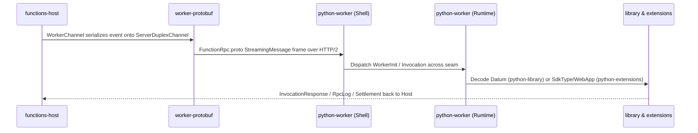

# 5-Repository Ecosystem Architecture

The Azure Functions Python stack is cleanly partitioned across **five GitHub repositories**, separating the `.NET` Script Host runtime, the language-neutral gRPC wire contract, the Python/Rust worker shells & runtimes, the customer-facing SDK, and optional framework/SDK extensions.

---

## Repository Boundaries & Cross-Repo Topology

<!-- BEGIN AUTO-GENERATED: ecosystem-reference -->

| Repository | PyPI Packages | Architectural Role |
| --- | --- | --- |
| [`Azure/azure-functions-host`](https://github.com/Azure/azure-functions-host) | — | .NET Functions Script Host runtime: event/trigger listeners, WorkerChannel gRPC server, Consumption specialization, scale probes, HTTP v2 proxy, and AppInsights/Kusto telemetry. |
| [`Azure/azure-functions-language-worker-protobuf`](https://github.com/Azure/azure-functions-language-worker-protobuf) | — | Canonical gRPC wire contract (`FunctionRpc.proto`, `settlement.proto`, `ClaimsIdentityRpc.proto`) shared between `azure-functions-host` and all language workers. |
| [`Azure/azure-functions-python-worker`](https://github.com/Azure/azure-functions-python-worker) | `azure-functions-runtime`, `azure-functions-runtime-v1` | Worker transports (monolith, proxy_worker, R2P2 Rust) and v1/v2 execution runtimes. |
| [`Azure/azure-functions-python-library`](https://github.com/Azure/azure-functions-python-library) | `azure-functions` | Customer-facing Python SDK: V2 @app decorators, Blueprints, Datum converters, Trigger/Binding types, Out[T], Context. |
| [`Azure/azure-functions-python-extensions`](https://github.com/Azure/azure-functions-python-extensions) | `azurefunctions-extensions-base`, `azurefunctions-extensions-http-fastapi`, `azurefunctions-extensions-bindings-blob`, `azurefunctions-extensions-bindings-servicebus`, `azurefunctions-agents-extensions-*` | Extension contracts: WebApp HTTP v2 streaming, SdkType deferred bindings, Settlement gRPC client, and Custom/Agent Runtime hooks. |

### Full 5-Repository Topology

```mermaid
flowchart LR
  subgraph ce_host["Azure/azure-functions-host (.NET Script Host)"]
    ne_host_chan["Script Host & WorkerChannel<br/>(functions-host)"]
    ne_host_duplex["ServerDuplexChannel & ShMem<br/>(functions-host)"]
  end
  subgraph ce_proto["Azure/azure-functions-language-worker-protobuf (Contract)"]
    ne_funcrpc["FunctionRpc.proto<br/>(worker-protobuf)"]
    ne_settle["settlement.proto & ClaimsIdentity<br/>(worker-protobuf)"]
  end
  subgraph ce_worker["Azure/azure-functions-python-worker"]
    subgraph ce_w_shell["Worker Transport Shells (workers/)"]
      ne_shells["Transports: Monolith / Proxy / R2P2<br/>(python-worker)"]
    end
    subgraph ce_w_rt["Execution Runtimes (runtimes/v1 & v2)"]
      ne_runtimes["azure-functions-runtime (v2 & v1)<br/>(python-worker)"]
    end
  end
  subgraph ce_lib["Azure/azure-functions-python-library"]
    ne_lib_dec["Decorators & Blueprints<br/>(python-library)"]
    ne_lib_datum["meta.py Datum & Converters<br/>(python-library)"]
  end
  subgraph ce_ext["Azure/azure-functions-python-extensions"]
    ne_ext_base["extensions-base (WebApp, SdkType, Runtime)<br/>(python-extensions)"]
    ne_ext_pkgs["FastAPI, SDK Bindings & Agent Runtimes<br/>(python-extensions)"]
  end
  ne_host_chan -->|"dispatch / RpcLog sink"| ne_host_duplex
  ne_host_duplex -->|"EventStream server"| ne_funcrpc
  ne_host_chan -.->|"Settlement server"| ne_settle
  ne_funcrpc -->|"prost / grpcio client"| ne_shells
  ne_shells -->|"WorkerRequest / PyO3 FFI"| ne_runtimes
  ne_runtimes -->|"index_function_app()"| ne_lib_dec
  ne_runtimes -->|"Datum <-> Binding decode"| ne_lib_datum
  ne_runtimes -->|"http_v2 / deferred SdkType"| ne_ext_base
  ne_shells -.->|"entry_points(azurefunctions.runtimes)"| ne_ext_base
  ne_settle -.->|"grpcClientType settlement"| ne_ext_base
  ne_ext_base -->|"metaclass registration"| ne_ext_pkgs
```

### End-to-End 5-Repo Request Lifecycle

### Key Cross-Repository Components

| Component | Repository | Source Anchor | Responsibility |
| --- | --- | --- | --- |
| **Script Host & WorkerChannel** | `functions-host` | [`src/WebJobs.Script.Grpc/Channel/WorkerChannel.cs`](https://github.com/Azure/azure-functions-host/blob/dev/src/WebJobs.Script.Grpc/Channel/WorkerChannel.cs) | .NET Script Host orchestrating triggers, worker process lifecycle, placeholder specialization, status probes, and RpcLog telemetry. |
| **ServerDuplexChannel & ShMem** | `functions-host` | [`src/WebJobs.Script.Grpc/Channel/ServerDuplexChannel.cs`](https://github.com/Azure/azure-functions-host/blob/dev/src/WebJobs.Script.Grpc/Channel/ServerDuplexChannel.cs) | Host-side bidirectional gRPC `EventStream` endpoint and POSIX/Windows shared-memory data transfer. |
| **FunctionRpc.proto** | `worker-protobuf` | [`src/proto/FunctionRpc.proto`](https://github.com/Azure/azure-functions-language-worker-protobuf/blob/dev/src/proto/FunctionRpc.proto) | Canonical bidirectional gRPC protocol contract shared between `azure-functions-host` and all out-of-proc language workers. |
| **settlement.proto & ClaimsIdentity** | `worker-protobuf` | [`src/proto/servicebus/settlement.proto`](https://github.com/Azure/azure-functions-language-worker-protobuf/blob/dev/src/proto/servicebus/settlement.proto) | Protobuf service schema enabling Python extensions to settle ServiceBus messages directly against the Host. |
| **Transports: Monolith / Proxy / R2P2** | `python-worker` | [`workers/r2p2/src/main.rs:L231`](https://github.com/Azure/azure-functions-python-worker/blob/dev/workers/r2p2/src/main.rs#L231) | Version-selected worker shell managing Host gRPC stream, logging, and sys.path dependency isolation. |
| **azure-functions-runtime (v2 & v1)** | `python-worker` | [`runtimes/v2/azure_functions_runtime/handle_event.py:L69`](https://github.com/Azure/azure-functions-python-worker/blob/dev/runtimes/v2/azure_functions_runtime/handle_event.py#L69) | PyPI-published execution engines that index apps, decode/encode bindings, and run sync/async handlers. |
| **Decorators & Blueprints** | `python-library` | [`azure/functions/__init__.py`](https://github.com/Azure/azure-functions-python-library/blob/dev/azure/functions/__init__.py) | Defines V2 Python programming model (`@app.route`, `@app.queue_trigger`, `Blueprint`, MCP & Connector triggers). |
| **meta.py Datum & Converters** | `python-library` | [`azure/functions/meta.py`](https://github.com/Azure/azure-functions-python-library/blob/dev/azure/functions/meta.py) | Protobuf-agnostic `Datum` value container and trigger/binding converters (`HttpRequest`, `QueueMessage`, `Blob`). |
| **extensions-base (WebApp, SdkType, Runtime)** | `python-extensions` | [`azurefunctions-extensions-base/azurefunctions/extensions/base/runtime.py`](https://github.com/Azure/azure-functions-python-extensions/blob/dev/azurefunctions-extensions-base/azurefunctions/extensions/base/runtime.py) | Metaclass registries bridging HTTP v2 ASGI servers, SDK-type deferred bindings, and custom Agent Runtimes. |
| **FastAPI, SDK Bindings & Agent Runtimes** | `python-extensions` | [`azurefunctions-extensions-http-fastapi/README.md`](https://github.com/Azure/azure-functions-python-extensions/blob/dev/azurefunctions-extensions-http-fastapi/README.md) | Concrete extension packages for FastAPI HTTP streaming, Blob/Cosmos/EventHub/ServiceBus SDK types, and Agents. |

<!-- END AUTO-GENERATED: ecosystem-reference -->

---

## How Contracts Connect the 5 Repositories

1. **`azure-functions-host` ↔ `azure-functions-language-worker-protobuf` ↔ `azure-functions-python-worker`**:
   - `WorkerChannel.cs` and `ServerDuplexChannel.cs` in `azure-functions-host` host the gRPC `FunctionRpc.EventStream` server defined by `FunctionRpc.proto`.
   - Neither `azure-functions-host` nor `FunctionRpc.proto` needed protocol changes when Python moved from the `≤ 3.12` monolith to `3.13` `proxy_worker` or `3.15+` Rust `r2p2`.
2. **`azure-functions-python-worker` ↔ `azure-functions-python-library`**:
   - `azure-functions` (`python-library`) defines `@app.*` decorators, `Blueprint`s, `Out[T]`, `Context`, and the protobuf-free `Datum(value, type)` intermediate representation (`azure/functions/meta.py`).
   - R2P2's `native_invocation.py` constructs `Datum` objects directly from Rust `PyO3` tuples—meaning standard triggers and bindings execute with **zero Python protobuf dependencies**.
3. **`azure-functions-python-worker` ↔ `azure-functions-python-extensions`**:
   - `azurefunctions-extensions-base` defines three metaclass extension seams:
     - `WebApp` (`web.py`) — local loopback ASGI/WSGI HTTP v2 streaming (`azurefunctions-extensions-http-fastapi`).
     - `SdkType` (`sdkType.py`) — deferred bindings hydrating rich Azure SDK clients (`BlobClient`, `ContainerClient`, Service Bus `ServiceBusReceivedMessage` + `settlement.proto` gRPC client).
     - `RuntimeTrackerMeta` (`runtime.py`) — custom execution engines discovered via `entry_points(group='azurefunctions.runtimes')` when `PYTHON_ENABLE_AGENT_RUNTIME=1`.
