# Three-Generation Evolution Overview

Historically, the Azure Functions Python worker shipped as a single monolithic package (`azure_functions_worker`) coupling gRPC transport, protobuf serialization, dependency isolation, indexing, bindings, and execution. Over Python `3.13` and `3.15`, the architecture evolved in two deliberate steps:

```mermaid
flowchart TB
    subgraph E1["Python <= 3.12 (Monolith)"]
        H1["Functions Host (.NET)"] <-->|"gRPC (grpcio + protobuf)"| M1["azure_functions_worker<br/>Transport + Indexing + Bindings + Executor"]
        M1 --> U1["Customer Function App"]
    end

    subgraph E2["Python 3.13 - 3.14 (Proxy + Runtime Split)"]
        H2["Functions Host (.NET)"] <-->|"gRPC (grpcio + protobuf)"| P2["proxy_worker<br/>Thin Transport Shell"]
        P2 -->|"In-Proc WorkerRequest<br/>+ injected protos"| R2["azure-functions-runtime (v2 / v1 / Agent)<br/>Independently Shipped on PyPI"]
        R2 --> U2["Customer Function App"]
    end

    subgraph E3["Python 3.15+ (R2P2 — Rust to Python Proxy)"]
        H3["Functions Host (.NET)"] <-->|"Same gRPC Wire<br/>(Rust tonic + prost)"| P3["r2p2 Native Binary<br/>Zero Python grpcio / protobuf"]
        P3 -->|"PyO3 FFI (GIL):<br/>Hot Datum Tuples / Control Dicts"| R3["Embedded CPython 3.15<br/>native_invocation.py + runtimes (v2 / v1)"]
        R3 --> U3["Customer Function App"]
    end
```

---

## Side-by-Side Architectural Comparison

| Architectural Dimension | Python ≤ 3.12 (Monolith) | Python 3.13 – 3.14 (Proxy Split) | Python 3.15+ (R2P2 Rust Worker) |
| --- | --- | --- | --- |
| **Source Path** | `workers/azure_functions_worker` | `workers/proxy_worker` + `runtimes/{v1,v2}` | `workers/r2p2` + `runtimes/{v1,v2}` |
| **Process & Launcher** | `prodV4/worker.py` → CPython | `proxyV4/worker.py` → CPython | Compiled `r2p2` Rust binary embedding `libpython3.15` (GIL) |
| **gRPC & Wire Codec** | Python `grpcio` + `google.protobuf` | Python `grpcio` + worker `protobuf` + `uvloop` | Native Rust `tonic` + `prost` + `tokio` (**0 Python protobuf**) |
| **Transport ↔ Runtime Seam** | None (direct internal imports) | In-process async `WorkerRequest` + injected `protos` | `PyO3` FFI: `invoke_native` `Datum` tuples (hot) + `protos_adapter` dicts (control) |
| **Runtime Release Cadence** | Coupled to Host worker image releases | Decoupled on PyPI (`azure-functions-runtime`) | Decoupled on PyPI (`azure-functions-runtime`) |
| **Day-1 New Python Support** | Blocked waiting for `grpcio` / `protobuf` C-extension wheels | Blocked waiting for `grpcio` / `protobuf` C-extension wheels | **Unblocked** — Rust owns wire; Python runtime is pure Python |
| **Customer Protobuf Collisions** | Vulnerable (`google.protobuf` C descriptor pool shared) | Mitigated via isolation, still shares C descriptor pool | **Eliminated permanently** — worker loads zero `google.protobuf` |
| **`WorkerStatusRequest` Probe** | Handled on Python `asyncio` loop (contends on GIL) | Short-circuited in `proxy_worker` (still contends on GIL) | **Zero-GIL pure Rust reply** (`src/bridge.rs`) |
| **V2 Function Indexing Phase** | Lazy in `FunctionsMetadataRequest` by default (`PYTHON_ENABLE_INIT_INDEXING` opt-in) | Eager during `WorkerInitRequest` / `EnvironmentReload` | Eager during `WorkerInitRequest` / `EnvironmentReload` |
| **Measured Throughput (GIL)** | Baseline (~339 req/s, p50 145 ms) | Parity (~339 req/s; PyPI agility win) | **+122% (754 req/s, p50 64 ms)** |

---

## Why Each Transition Happened

### 1. Why Split `proxy_worker` and `runtimes/` in Python 3.13?
In `≤ 3.12`, shipping any binding fix, OpenTelemetry enhancement, or HTTP v2 streaming improvement required rebuilding and rolling out the entire worker bundle across Azure Functions Host images for every Python version. Splitting `proxy_worker` (thin, rarely changing transport) from `azure-functions-runtime` (PyPI-published execution engine) decoupled their release cadences and unlocked third-party/custom **Agent Runtimes** (`PYTHON_ENABLE_AGENT_RUNTIME=1`).

### 2. Why Move the Proxy Shell to Rust (`R2P2`) in Python 3.15?
Even with the 3.13 split, `proxy_worker` remained written in Python and linked `grpcio` and `google.protobuf` C-extensions:

1. **New Python release bottleneck**: `grpcio` and `protobuf` C-extension wheels routinely lag new CPython releases, blocking day-one Python 3.15+ support on Azure Functions.
2. **Descriptor-pool collisions**: Sharing an interpreter between worker `protobuf` and customer-pinned `protobuf` packages caused recurring packaging friction.
3. **Transport overhead**: Replacing `grpcio` + Python protobuf marshaling with native `tonic` + `prost` + a direct `PyO3` `Datum`-tuple FFI seam (`native_invocation.py`) delivered **+122% higher throughput** on the standard GIL build while keeping `runtimes/v1`, `runtimes/v2`, and customer code 100% Python.
