# Python ≤ 3.12 Architecture — Monolithic Worker

For **Python 3.7 through 3.12**, the worker ships as a single monolithic Python package under [`workers/azure_functions_worker`](https://github.com/Azure/azure-functions-python-worker/tree/dev/workers/azure_functions_worker), launched by [`workers/python/prodV4/worker.py`](https://github.com/Azure/azure-functions-python-worker/blob/dev/workers/python/prodV4/worker.py).

Transport (`grpcio` + `google.protobuf`), `DependencyManager`, function indexing (`loader.py`), binding serialization (`bindings/`), shared-memory transfer (`SharedMemoryManager`), HTTP v2 streaming (`http_v2.py`), worker extensions (`extension.py`), and the synchronous `ThreadPoolExecutor` (`_sync_call_tp`) all reside inside one coupled module tree.

---

## Architecture & Component Reference

<!-- BEGIN AUTO-GENERATED: py312-components -->

### Full Static Topology (Mermaid)

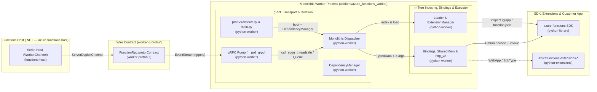

### Component & Source Reference

| Component | Repository | Source Anchor | Responsibility |
| --- | --- | --- | --- |
| **Script Host (WorkerChannel)** | `functions-host` | [`src/WebJobs.Script.Grpc/Channel/WorkerChannel.cs`](https://github.com/Azure/azure-functions-host/blob/dev/src/WebJobs.Script.Grpc/Channel/WorkerChannel.cs) | .NET Functions Host runtime spawning `prodV4/worker.py`, driving triggers, scale probes, and telemetry. |
| **FunctionRpc.proto Contract** | `worker-protobuf` | [`src/proto/FunctionRpc.proto`](https://github.com/Azure/azure-functions-language-worker-protobuf/blob/dev/src/proto/FunctionRpc.proto) | Language-neutral gRPC `.proto` contract between `azure-functions-host` and `azure_functions_worker`. |
| **prodV4/worker.py & main.py** | `python-worker` | [`workers/azure_functions_worker/main.py:L70`](https://github.com/Azure/azure-functions-python-worker/blob/dev/workers/azure_functions_worker/main.py#L70) | Sets worker-first sys.path so bundled `grpcio`/`protobuf` import cleanly, then starts asyncio loop. |
| **gRPC Pump (__poll_grpc)** | `python-worker` | [`workers/azure_functions_worker/dispatcher.py:L155`](https://github.com/Azure/azure-functions-python-worker/blob/dev/workers/azure_functions_worker/dispatcher.py#L155) | Background OS thread reading `stub.EventStream` and posting tasks via `call_soon_threadsafe`. |
| **Monolithic Dispatcher** | `python-worker` | [`workers/azure_functions_worker/dispatcher.py:L90`](https://github.com/Azure/azure-functions-python-worker/blob/dev/workers/azure_functions_worker/dispatcher.py#L90) | Central class owning message routing, logging switch, OTel/AppInsights setup, and `_sync_call_tp`. |
| **DependencyManager** | `python-worker` | [`workers/azure_functions_worker/utils/dependency.py:L25`](https://github.com/Azure/azure-functions-python-worker/blob/dev/workers/azure_functions_worker/utils/dependency.py#L25) | Manages worker-first placeholder boot vs customer `.python_packages` promotion on Init/Specialization. |
| **Loader & ExtensionManager** | `python-worker` | [`workers/azure_functions_worker/loader.py:L249`](https://github.com/Azure/azure-functions-python-worker/blob/dev/workers/azure_functions_worker/loader.py#L249) | Indexes V2 `@app` decorators or V1 `function.json` files and invokes `AppExtensionBase` hooks. |
| **Bindings, SharedMem & http_v2** | `python-worker` | [`workers/azure_functions_worker/http_v2.py:L261`](https://github.com/Azure/azure-functions-python-worker/blob/dev/workers/azure_functions_worker/http_v2.py#L261) | Converts `protos.TypedData` <-> `Datum`, manages shared-memory rings, and coordinates HTTP v2 streaming. |
| **azure-functions SDK** | `python-library` | [`azure/functions/meta.py`](https://github.com/Azure/azure-functions-python-library/blob/dev/azure/functions/meta.py) | Customer decorators, trigger/binding models (`HttpRequest`, `QueueMessage`), and `Datum` converters. |
| **azurefunctions-extensions-*** | `python-extensions` | [`azurefunctions-extensions-base/azurefunctions/extensions/base/sdkType.py`](https://github.com/Azure/azure-functions-python-extensions/blob/dev/azurefunctions-extensions-base/azurefunctions/extensions/base/sdkType.py) | Optional HTTP v2 ASGI streaming (`WebApp`) and deferred SDK bindings (`BlobClient`, etc.). |

<!-- END AUTO-GENERATED: py312-components -->

---

## The 7 Worker Lifecycle Phases (Python ≤ 3.12)

Each Host ↔ Worker lifecycle phase exercises a distinct subset of components and interactions in `azure_functions_worker`.

<!-- BEGIN AUTO-GENERATED: py312-phases -->

### 1. Worker Initialization Flow

---

- **Wire Protocol:** `StartStream → WorkerInitRequest → WorkerInitResponse`

---

- **Execution Scope:** All SKUs (Cold Start)

---

Host spawns `prodV4/worker.py`, which boots `azure_functions_worker` with worker dependencies isolated first (`grpcio` + `protobuf`). Once `EventStream` connects and sends `StartStream`, `WorkerInitRequest` negotiates capabilities (`SHARED_MEMORY`, `RAW_HTTP_BODY_BYTES`, `WORKER_STATUS`), initializes OTel/AppInsights, promotes customer `.python_packages` (on Dedicated/EP), loads the binding registry, and optionally pre-indexes if `PYTHON_ENABLE_INIT_INDEXING=1`.

---

> **Bypassed / Idle Note:** In Linux Consumption placeholder mode, customer packages are NOT mounted yet during Init (deferred to Phase 2 Specialization).

---

#### Sequence Diagram

---

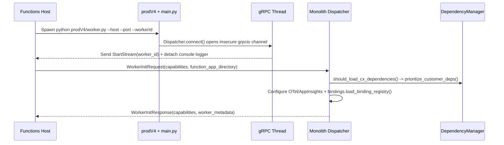

---

#### Phase Compound Topology

---

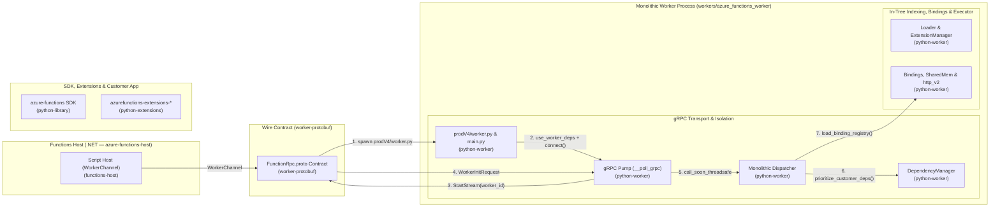

---

### 2. Worker Specialization Flow (Consumption Placeholder)

---

- **Wire Protocol:** `FunctionEnvironmentReloadRequest → FunctionEnvironmentReloadResponse`

---

- **Execution Scope:** Linux / Flex Consumption Only (Placeholder Mode)

---

Warm standby containers boot before any customer app is assigned. When specialized, the Host mounts the customer package and sends `FunctionEnvironmentReloadRequest` carrying `function_app_directory` and `environment_variables`. The monolith clears `os.environ`, calls `time.tzset()`, clears `sys.path_importer_cache`, promotes customer `.python_packages`, recreates `_sync_call_tp` (`PYTHON_THREADPOOL_THREAD_COUNT`), and changes `cwd`.

---

> **Bypassed / Idle Note:** Never sent on Dedicated/Premium cold boots or worker restarts (those go straight through WorkerInit).

---

#### Sequence Diagram

---

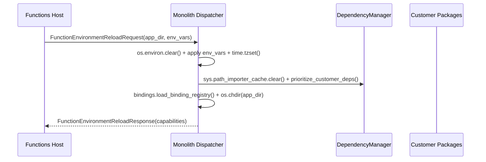

---

#### Phase Compound Topology

---

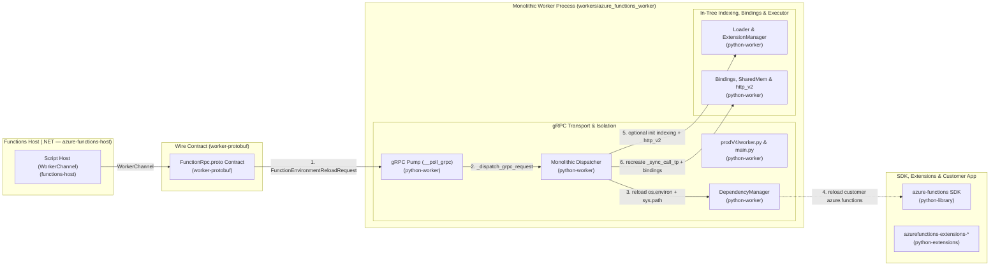

---

### 3. Worker Metadata & Indexing Flow

---

- **Wire Protocol:** `FunctionsMetadataRequest → FunctionMetadataResponse`

---

- **Execution Scope:** V2 Worker-Indexed Apps (Returns Fallback Flag for V1)

---

Host asks the worker whether it owns function discovery. In `≤ 3.12`, `load_function_metadata()` checks if `function_app.py` exists: for **V2**, it imports `function_app.py`, walks `@app` decorators and `Blueprint`s (`python-library`) plus `WebApp`/`SdkType` hooks (`python-extensions`), and returns `RawFunctionMetadata` (`use_default_metadata_indexing=False`). For **V1**, it returns `use_default_metadata_indexing=True` so the Host scans `function.json` directories itself.

---

> **Bypassed / Idle Note:** For V1 apps (`function.json`), no customer Python code is imported during Metadata — Host falls back to disk scanning.

---

#### Sequence Diagram

---

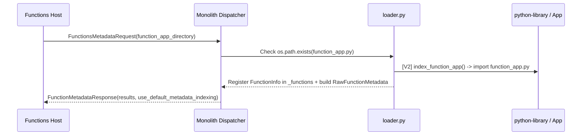

---

#### Phase Compound Topology

---

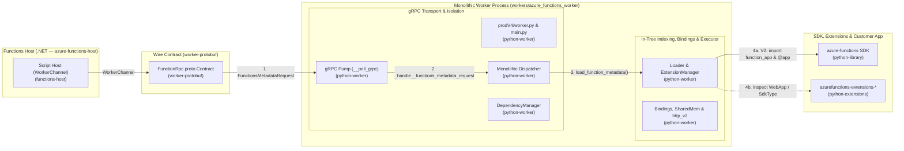

---

### 4. Worker Functions Load Flow (V1 Primary)

---

- **Wire Protocol:** `FunctionLoadRequest → FunctionLoadResponse`

---

- **Execution Scope:** V1 Programming Model (`function.json`); V2 Multi-Worker / Ack

---

After the Host parses `function.json` files for a **V1** app, it sends one `FunctionLoadRequest` per function with `script_file`, `entry_point`, and `bindings`. `loader.load_function()` imports the target Python module (`__init__.py`), validates parameter type annotations against `bindings/`, and stores `FunctionInfo` in `self._functions`. (For V2 single-worker, `_functions` already holds the function from Phase 3, so it fast-acks; for 2nd+ workers in multi-proc mode, it triggers lazy V2 indexing).

---

> **Bypassed / Idle Note:** For standard V2 apps, user scripts were already loaded in Phase 3 Metadata, making FunctionLoad a fast registry check.

---

#### Sequence Diagram

---

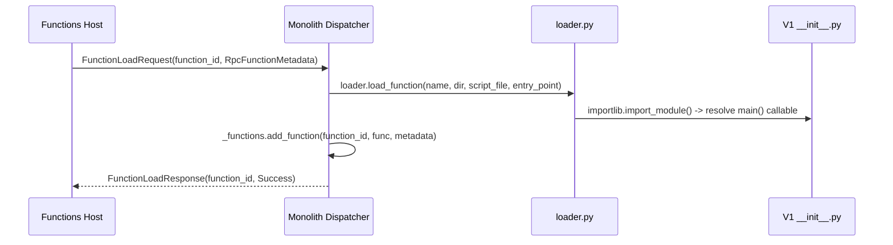

---

#### Phase Compound Topology

---

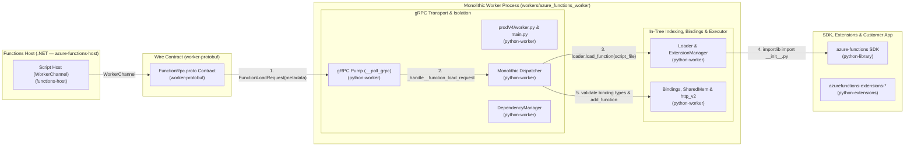

---

### 5. Worker Invocation Flow

---

- **Wire Protocol:** `InvocationRequest → InvocationResponse`

---

- **Execution Scope:** Every Function Trigger Execution

---

Host sends `InvocationRequest` with `input_data` (`TypedData` or POSIX/Win shared-memory map) and `trigger_metadata`. `Dispatcher` decodes bindings via `python-library` (`Datum`) or `python-extensions` (`SdkType` / `http_v2`), sets W3C OpenTelemetry context, executes `async def` on the event loop or `def` on `_sync_call_tp`, and marshals `Out[T]` + `$return` back to protobuf.

---

> **Bypassed / Idle Note:** `prodV4` boot and `loader.py` are idle during steady-state invocations.

---

#### Sequence Diagram

---

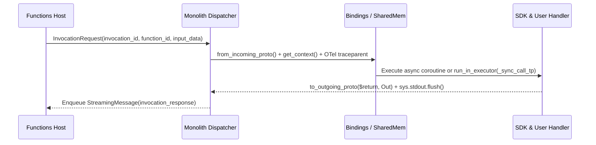

---

#### Phase Compound Topology

---

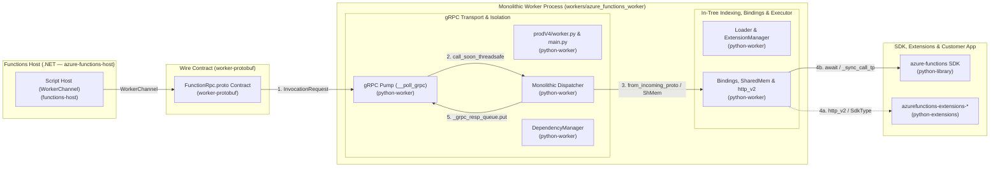

---

### 6. Worker Status Flow (Host Health & Scale Probe)

---

- **Wire Protocol:** `WorkerStatusRequest → WorkerStatusResponse`

---

- **Execution Scope:** Host Scale Controller & Worker Health Monitoring

---

The Host periodically sends `WorkerStatusRequest` to measure worker round-trip responsiveness for out-of-proc scaling decisions. In `≤ 3.12`, `_handle__worker_status_request` suppresses all logging and returns an empty `WorkerStatusResponse` immediately—**however**, it still hop-schedules onto the single Python `asyncio` event loop and acquires the GIL.

---

> **Bypassed / Idle Note:** Loader, Bindings, SDK, Extensions, and User Code are completely untouched — pure transport/loop health probe.

---

#### Sequence Diagram

---

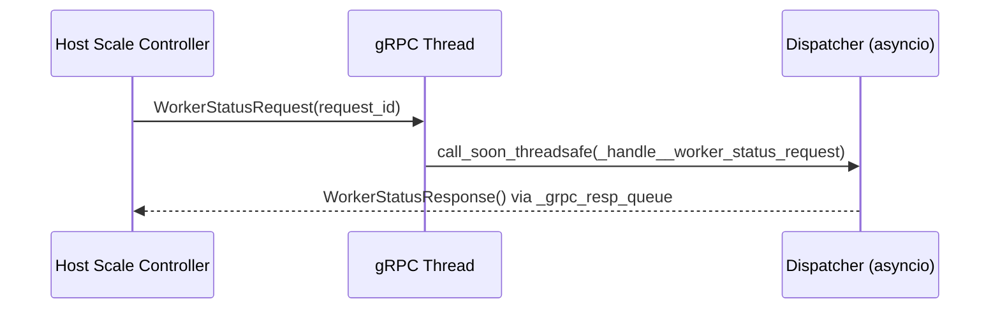

---

#### Phase Compound Topology

---

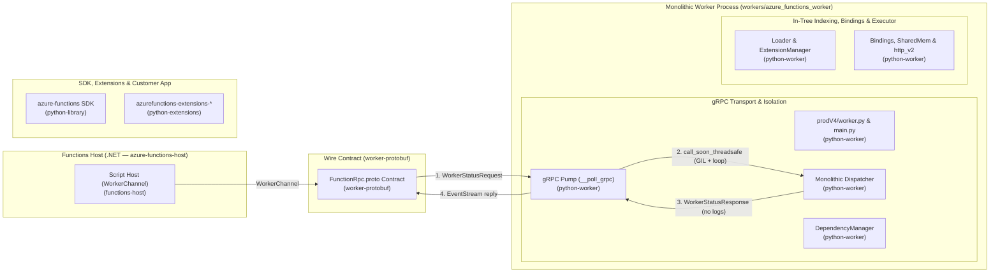

---

### 7. Worker Logs Flow (Worker → Host Reverse Stream)

---

- **Wire Protocol:** `Python logging.LogRecord → StreamingMessage(RpcLog) → Host`

---

- **Execution Scope:** Reverse Telemetry Stream (System & Customer Logs)

---

Before `EventStream` connects, logs print to stdout/stderr with prefix `LanguageWorkerConsoleLog`. Once connected, `disable_console_logging()` detaches console output and attaches `AsyncLoggingHandler` to the root logger. Every `logging.info/error` from customer code (`User` category) or worker (`System` category) is stamped with `invocation_id` (from task/thread-local) and pushed **back to the Host** on `_grpc_resp_queue` as `RpcLog` messages for Application Insights & Kusto.

---

> **Bypassed / Idle Note:** Originates inside User Code or Worker internals and flows RIGHT → LEFT back to the Host without a Host request.

---

#### Sequence Diagram

---

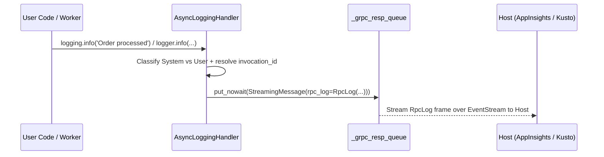

---

#### Phase Compound Topology

---

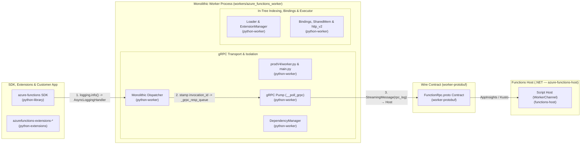

<!-- END AUTO-GENERATED: py312-phases -->
