# Python 3.13 – 3.14 Architecture — Split Proxy Worker & Runtimes

Starting in **Python 3.13**, the monolithic worker was split into two independently versioned layers:

1. **Proxy Worker (`workers/proxy_worker`, launched via `workers/python/proxyV4/worker.py`)**: A thin, stable transport shell that owns the `grpcio` `EventStream`, `uvloop` policy, console-to-`RpcLog` logging switch, 4-tier `invocation_id` correlation, `WorkerStatusRequest` fast-path, and `DependencyManager` `sys.path` isolation.
2. **Execution Runtimes (`runtimes/v2` → `azure-functions-runtime` and `runtimes/v1` → `azure-functions-runtime-v1`)**: Independently PyPI-published execution engines invoked in-process across a narrow 5-verb `WorkerRequest` coroutine contract.

> **Why inject `protos` at `WorkerInitRequest`?**
> `proxy_worker` passes `properties={"protos": protos, "host": self._host}` on `worker_init_request` and `function_environment_reload_request`. The runtime caches `protos` in a module global, decoupling PyPI runtime releases from specific `protobuf` C-extension wheel builds.

---

## Runtime Selection Priority (`reload_library_worker`)

During `WorkerInitRequest` (and again on `FunctionEnvironmentReloadRequest`), `Dispatcher.reload_library_worker(directory)` selects the execution engine in strict priority order:

1. **Custom / Agent Runtime (`PYTHON_ENABLE_AGENT_RUNTIME=1`)**: Discovers `importlib.metadata.entry_points(group="azurefunctions.runtimes")` and loads the registered package via `azurefunctions.extensions.base.RuntimeTrackerMeta`.
2. **V2 Decorator Runtime (`azure_functions_runtime`)**: Selected when `function_app.py` (or `PYTHON_SCRIPT_FILE_NAME`) exists in the app directory. Indexes functions eagerly during `WorkerInit` / `EnvironmentReload`.
3. **V1 Classic Runtime (`azure_functions_runtime_v1`)**: Selected when no V2 script file exists; relies on Host `function.json` scanning followed by per-function `FunctionLoadRequest`.

---

## Architecture & Component Reference

<!-- BEGIN AUTO-GENERATED: py313_314-components -->

### Full Static Topology (Mermaid)

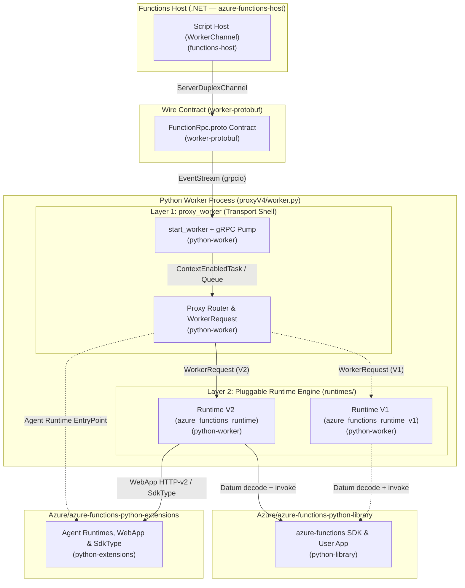

### Component & Source Reference

| Component | Repository | Source Anchor | Responsibility |
| --- | --- | --- | --- |
| **Script Host (WorkerChannel)** | `functions-host` | [`src/WebJobs.Script.Grpc/Channel/WorkerChannel.cs`](https://github.com/Azure/azure-functions-host/blob/dev/src/WebJobs.Script.Grpc/Channel/WorkerChannel.cs) | .NET Functions Host runtime spawning `proxyV4/worker.py` (`python -m proxy_worker`) for Python 3.13/3.14. |
| **FunctionRpc.proto Contract** | `worker-protobuf` | [`src/proto/FunctionRpc.proto`](https://github.com/Azure/azure-functions-language-worker-protobuf/blob/dev/src/proto/FunctionRpc.proto) | Canonical gRPC wire schema compiled into `proxy_worker/protos` and injected into PyPI runtimes. |
| **start_worker + gRPC Pump** | `python-worker` | [`workers/proxy_worker/dispatcher.py:L278`](https://github.com/Azure/azure-functions-python-worker/blob/dev/workers/proxy_worker/dispatcher.py#L278) | Locks worker deps first, enables `uvloop`, opens `grpcio` stream, and switches console -> `RpcLog`. |
| **Proxy Router & WorkerRequest** | `python-worker` | [`workers/proxy_worker/dispatcher.py:L326`](https://github.com/Azure/azure-functions-python-worker/blob/dev/workers/proxy_worker/dispatcher.py#L326) | Promotes customer deps, dynamically selects V2 / V1 / Agent runtime, and passes `WorkerRequest` + `protos`. |
| **Runtime V2 (azure_functions_runtime)** | `python-worker` | [`runtimes/v2/azure_functions_runtime/handle_event.py:L69`](https://github.com/Azure/azure-functions-python-worker/blob/dev/runtimes/v2/azure_functions_runtime/handle_event.py#L69) | PyPI V2 engine: decorator indexing, `Datum` bindings, HTTP v2 streaming, OpenTelemetry, threadpool. |
| **Runtime V1 (azure_functions_runtime_v1)** | `python-worker` | [`runtimes/v1/azure_functions_runtime_v1/handle_event.py:L53`](https://github.com/Azure/azure-functions-python-worker/blob/dev/runtimes/v1/azure_functions_runtime_v1/handle_event.py#L53) | PyPI V1 engine supporting classic `function.json` apps across the exact same 5-verb contract. |
| **azure-functions SDK & User App** | `python-library` | [`azure/functions/__init__.py`](https://github.com/Azure/azure-functions-python-library/blob/dev/azure/functions/__init__.py) | Customer `function_app.py` + `azure-functions` SDK types invoked on asyncio loop or threadpool. |
| **Agent Runtimes, WebApp & SdkType** | `python-extensions` | [`azurefunctions-extensions-base/azurefunctions/extensions/base/runtime.py`](https://github.com/Azure/azure-functions-python-extensions/blob/dev/azurefunctions-extensions-base/azurefunctions/extensions/base/runtime.py) | Custom `azurefunctions.runtimes` entry points (`PYTHON_ENABLE_AGENT_RUNTIME`), FastAPI HTTP v2, and SDK bindings. |

<!-- END AUTO-GENERATED: py313_314-components -->

---

## The 7 Worker Lifecycle Phases (Python 3.13 – 3.14)

<!-- BEGIN AUTO-GENERATED: py313_314-phases -->

### 1. Worker Initialization Flow (Runtime Selection + V2 Default Indexing)

---

- **Wire Protocol:** `StartStream → WorkerInitRequest → WorkerRequest(protos) → WorkerInitResponse`

---

- **Execution Scope:** All SKUs (Cold Start)

---

`proxyV4/worker.py` starts `proxy_worker` with `uvloop` and worker-first deps (`grpcio`/`protobuf`). On `WorkerInitRequest`, `proxy_worker` promotes customer deps, runs **`reload_library_worker(dir)`** (resolving `PYTHON_ENABLE_AGENT_RUNTIME` `entry_points` → `function_app.py` V2 → V1), starts the runtime threadpool, and passes `WorkerRequest(properties={'protos': protos, 'host': host})`. **Key change in 3.13+**: Runtime V2 now **indexes `function_app.py` and starts `http_v2` during `WorkerInit`**!

---

> **Bypassed / Idle Note:** Only ONE runtime engine (Agent, V2, or V1) is imported and bound to `_library_worker`.

---

#### Sequence Diagram

---

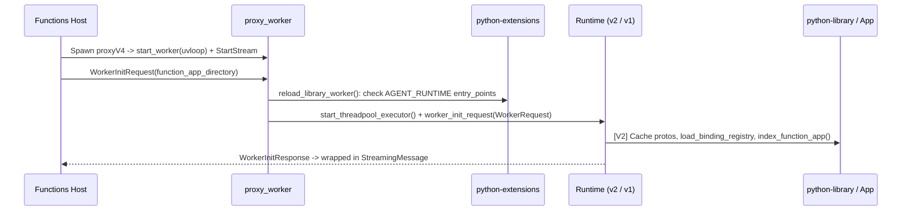

---

#### Phase Compound Topology

---

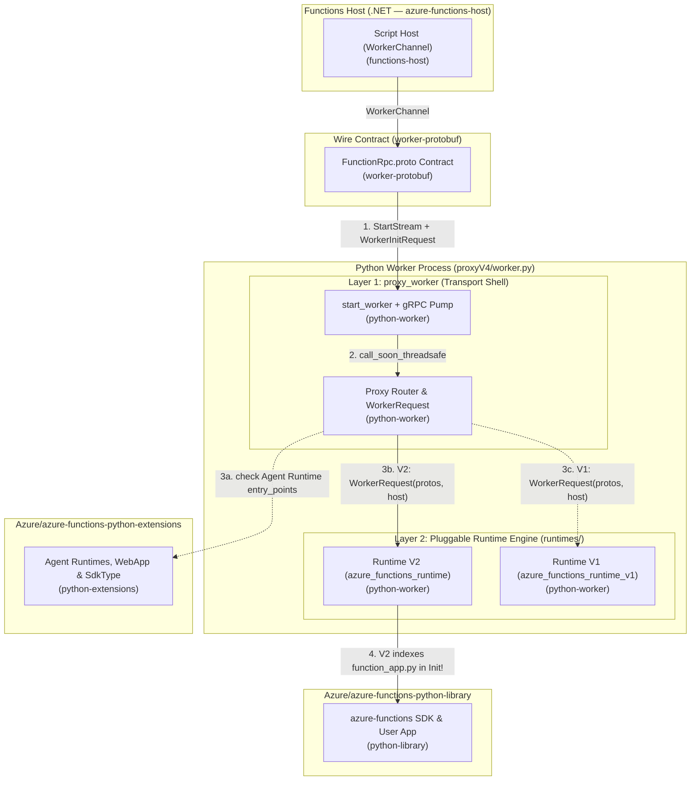

---

### 2. Worker Specialization Flow (Consumption Runtime Swap)

---

- **Wire Protocol:** `FunctionEnvironmentReloadRequest → reload_library_worker() → ReloadResponse`

---

- **Execution Scope:** Linux / Flex Consumption Only (Placeholder Mode)

---

During placeholder boot, the worker defaulted to bundled `azure_functions_runtime`. On `FunctionEnvironmentReloadRequest`, `proxy_worker` promotes the newly mounted customer `.python_packages`, **re-runs `reload_library_worker(directory)`** (so a V1 app switches to `azure_functions_runtime_v1`, an Agent app loads its custom runtime, or a customer-pinned PyPI `azure-functions-runtime` takes over!), re-injects `protos`, reloads `os.environ` + `tzset()`, and indexes the specialized app.

---

> **Bypassed / Idle Note:** Only occurs when specializing warm Consumption standby containers.

---

#### Sequence Diagram

---

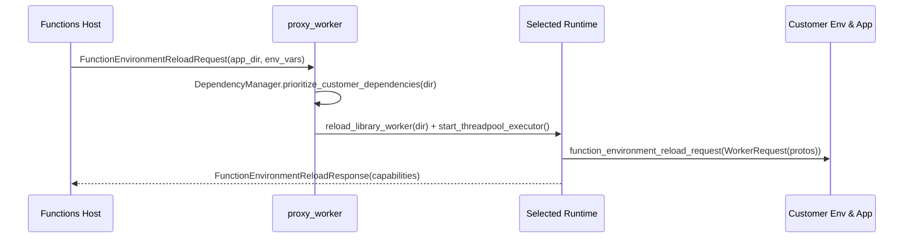

---

#### Phase Compound Topology

---

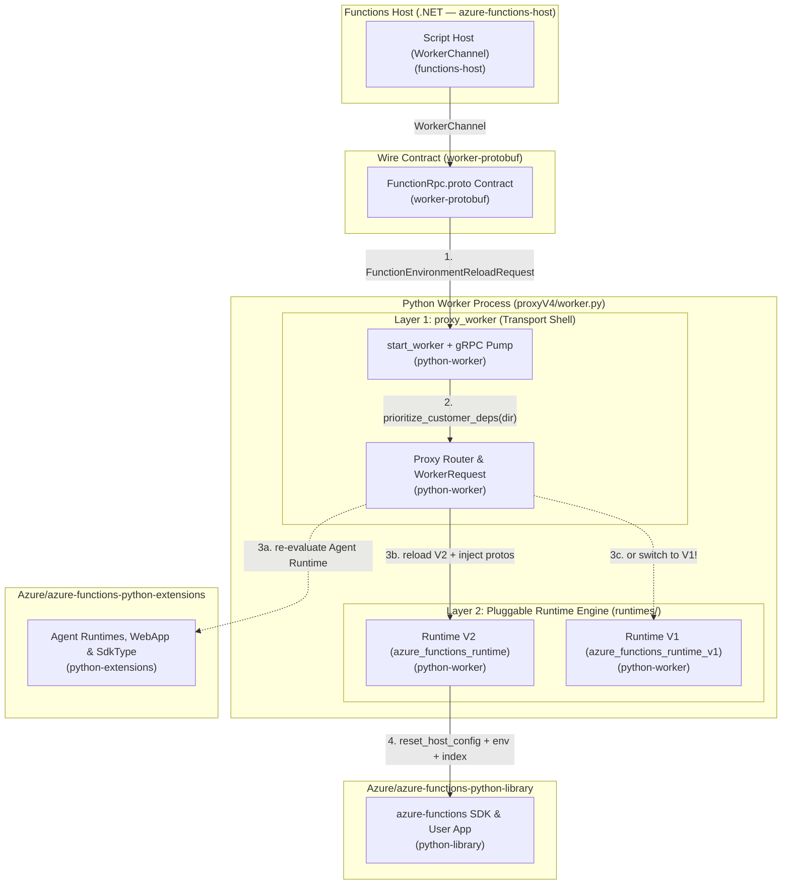

---

### 3. Worker Metadata Flow (Cached V2 Result vs V1 Host Fallback)

---

- **Wire Protocol:** `FunctionsMetadataRequest → WorkerRequest → FunctionMetadataResponse`

---

- **Execution Scope:** V2 Returns Cached Metadata; V1 Delegates Indexing to Host

---

`proxy_worker` forwards `WorkerRequest(name='WorkerMetadataRequest')` (no `protos` needed — already cached in runtime!). In **Runtime V2**, `functions_metadata_request` immediately returns the `_metadata_result` indexed during Init/Specialization (`use_default_metadata_indexing=False`). In **Runtime V1**, it returns `use_default_metadata_indexing=True, results=None` so the Host reads `function.json` files.

---

> **Bypassed / Idle Note:** V2 already indexed `function_app.py` during Init/Specialization, so Phase 3 is an O(1) cached return!

---

#### Sequence Diagram

---

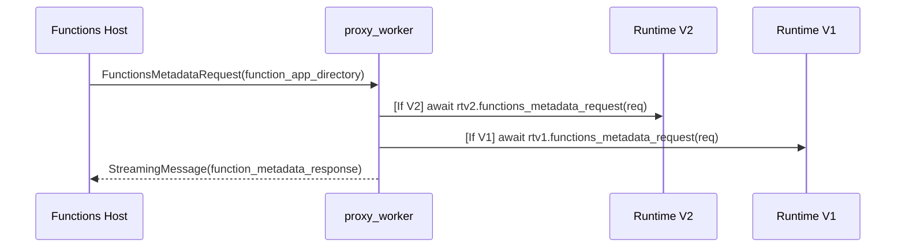

---

#### Phase Compound Topology

---

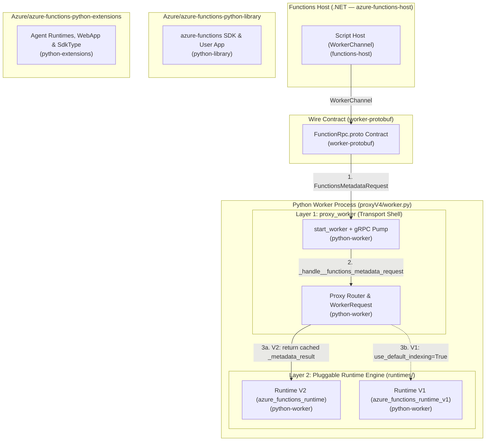

---

### 4. Worker Functions Load Flow (V1 Script Loading vs V2 No-Op)

---

- **Wire Protocol:** `FunctionLoadRequest → WorkerRequest → FunctionLoadResponse`

---

- **Execution Scope:** Active Import for V1 (`runtimes/v1`); Immediate No-Op Ack for V2

---

The split makes V1 vs V2 load behavior explicit: **`runtimes/v1/handle_event.py`** implements real `load_function()` + `_functions.add_function(function_id, func, metadata, protos)` to import each `function.json` script; **`runtimes/v2/handle_event.py`** (`L160`) is a 6-line immediate `FunctionLoadResponse(Success)` because V2 functions were already loaded during indexing!

---

> **Bypassed / Idle Note:** In Runtime V2, `function_load_request` is a pure no-op acknowledgment.

---

#### Sequence Diagram

---

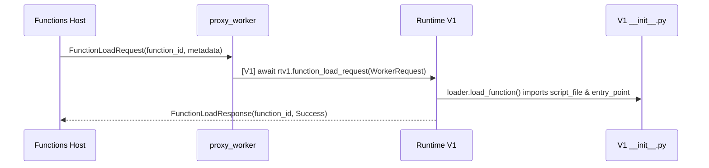

---

#### Phase Compound Topology

---

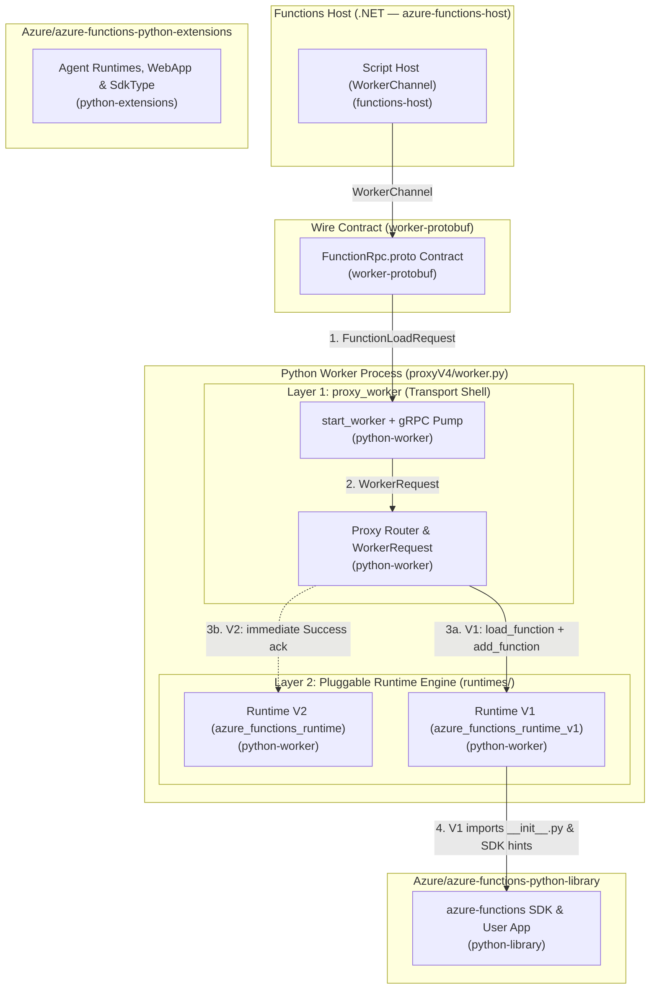

---

### 5. Worker Invocation Flow

---

- **Wire Protocol:** `InvocationRequest → WorkerRequest → Runtime v2/v1 → InvocationResponse`

---

- **Execution Scope:** Every Function Trigger Execution

---

`proxy_worker` stamps the `ContextEnabledTask` with `invocation_id` and awaits `_library_worker.invocation_request(WorkerRequest)`. The runtime decodes inputs using its cached `protos`, coordinates `http_v2` streaming or `SdkType` bindings (`python-extensions`), executes async on `uvloop` or sync on the runtime's `ThreadPoolExecutor`, and returns `InvocationResponse`.

---

> **Bypassed / Idle Note:** Runtime discovery and `protos` injection do NOT run per-invocation — cached from Phase 1/2.

---

#### Sequence Diagram

---

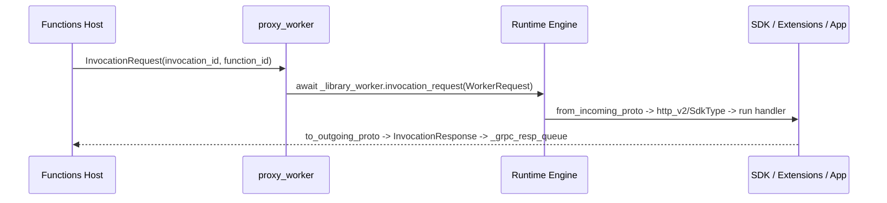

---

#### Phase Compound Topology

---

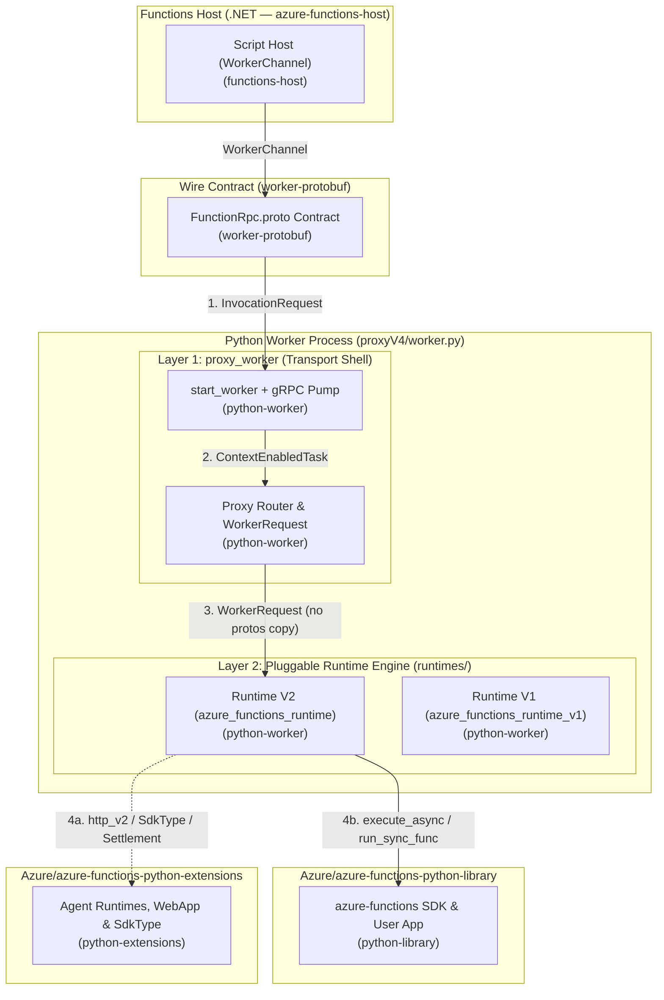

---

### 6. Worker Status Flow (Proxy Short-Circuit)

---

- **Wire Protocol:** `WorkerStatusRequest → proxy_worker → WorkerStatusResponse`

---

- **Execution Scope:** Host Scale Controller Health Check (Runtime Bypassed!)

---

In `3.13 – 3.14`, `_handle__worker_status_request` is the **only** message handler in `proxy_worker/dispatcher.py` that **does NOT delegate to `_library_worker`**! It short-circuits inside `proxy_worker` and returns `WorkerStatusResponse` immediately—though it still runs on the shared CPython interpreter's `uvloop` and GIL.

---

> **Bypassed / Idle Note:** Runtime V2, Runtime V1, SDK, Extensions, and Customer App are 100% bypassed!

---

#### Sequence Diagram

---

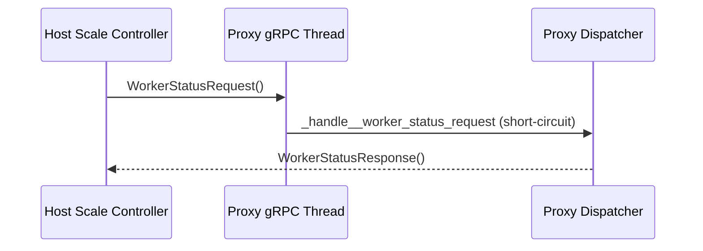

---

#### Phase Compound Topology

---

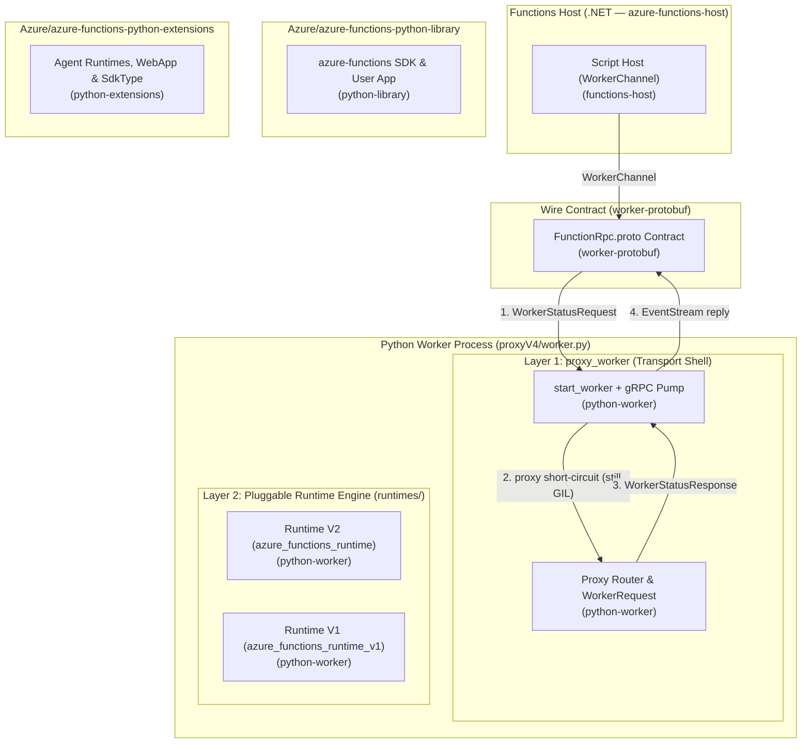

---

### 7. Worker Logs Flow (4-Tier Invocation-ID Correlation → Host)

---

- **Wire Protocol:** `LogRecord → 4-Tier ID Resolver → StreamingMessage(RpcLog) → Host`

---

- **Execution Scope:** Reverse Telemetry Stream (Worker / Runtime / Customer → Host)

---

Because execution lives in a separate PyPI runtime package (or custom Agent Runtime), `proxy_worker`'s `AsyncLoggingHandler` resolves `invocation_id` across **4 fallback tiers**: 1) global tracker (for custom runtimes without `cv`), 2) `ContextEnabledTask` attribute, 3) `_library_worker.invocation_id_cv` (`ContextVar`), and 4) `_thread_invocation_registry`—then streams `RpcLog` frames back to the Host.

---

> **Bypassed / Idle Note:** Flows RIGHT → LEFT from User App / Runtime loggers through proxy_worker's AsyncLoggingHandler to the Host.

---

#### Sequence Diagram

---

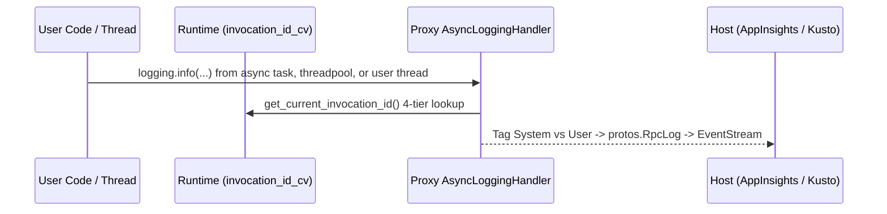

---

#### Phase Compound Topology

---

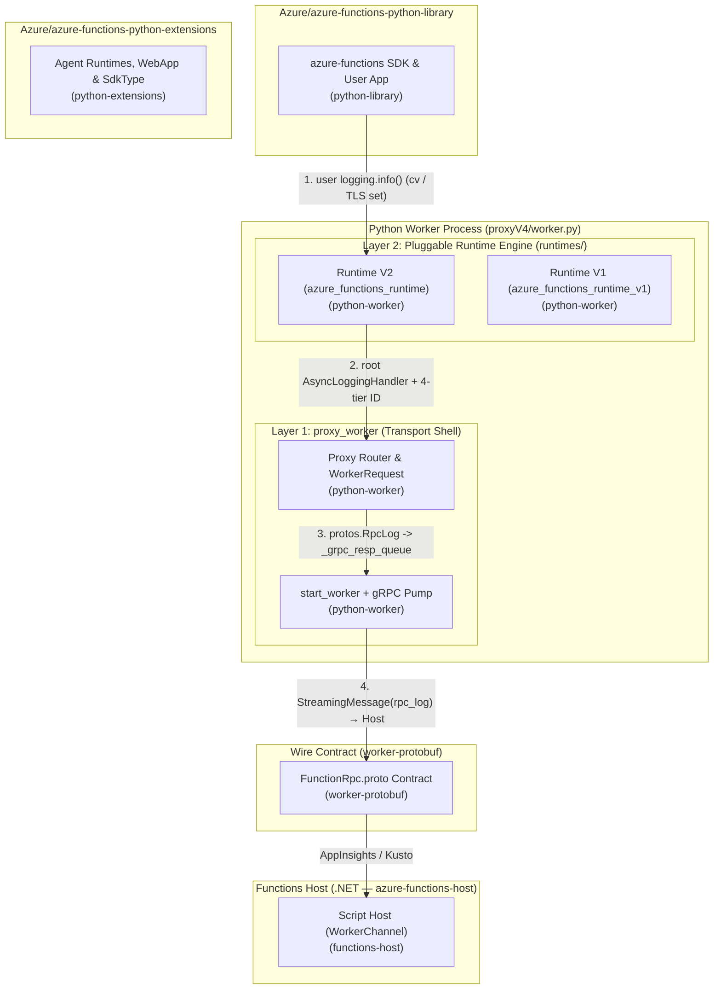

<!-- END AUTO-GENERATED: py313_314-phases -->
