# Python 3.15+ Architecture — R2P2 (Rust to Python Proxy)

For **Python 3.15+**, **R2P2** ([`workers/r2p2`](https://github.com/Azure/azure-functions-python-worker/tree/dev/workers/r2p2)) replaces the Python `proxy_worker` with a compiled native **Rust** binary that embeds CPython (`libpython3.15`, **GIL** build) in-process via **`PyO3`**, while keeping function discovery, bindings, and user execution in the existing Python runtime libraries (`runtimes/v2` and `runtimes/v1`).

---

## Key Architectural Innovations in R2P2

### 1. Zero Python `grpcio` or `google.protobuf`
Rust owns every byte on the Host wire using **`tonic`** (HTTP/2 gRPC + `BytesCodec`), **`prost`** (generated from vendored `FunctionRpc.proto` in `build.rs`), and multi-threaded **`tokio`**. Nothing in the embedded Python interpreter imports `grpc` or `google.protobuf`, eliminating wheel-lag blockers for new Python versions and ending customer `protobuf` descriptor-pool collisions.

### 2. Dual FFI Execution Paths (Hot Native Seam vs Control Adapter)
After indexing, `main.rs` memoizes `needs_control_path(function_id)` once per function:

- **Hot Native Path (`needs_control_path == false`)**: Standard triggers and bindings (`HttpRequest`, `HttpResponse`, `QueueMessage`, `TimerRequest`, `Out[T]`) are decoded by `prost` in Rust, converted by `src/convert.rs` into compact `(type_tag, primitive_or_dict)` **PyO3 datum tuples**, and passed straight into `azure_functions_runtime.native_invocation`—delivering **+122% higher req/s** (`754` vs `339` req/s on the GIL build).
- **Control & Extensions Path (`needs_control_path == true` or lifecycle messages)**: `WorkerInit`, `EnvironmentReload`, `FunctionsMetadata`, `FunctionLoad`, and functions using `python-extensions` (`http_v2` ASGI/FastAPI streaming or `SdkType` deferred bindings) convert `prost` structs to `PyDict`s (`src/control.rs`) and run the standard `handle_event.py` coroutines against `workers/r2p2/bridge/protos_adapter.py` (a pure-Python `protos` stand-in).

### 3. Zero-GIL Scale Probes & Lock-Free `LogSink`
- **`WorkerStatusRequest`**: Matched directly in `src/bridge.rs` and answered in pure Rust without calling `Python::attach` or acquiring the GIL.
- **Reverse `RpcLog` Telemetry**: Python's `_RpcLogHandler` resolves `invocation_id` from `_rt.invocation_id_cv` or `_rt_tls` (`context.thread_local_storage` for customer-spawned threads) and calls `#[pyclass] LogSink.emit_log(dict)`, which `prost`-encodes and enqueues onto a single lock-free `tokio::sync::mpsc::UnboundedSender<Bytes>` without blocking GIL threads.

---

## Architecture & Component Reference

<!-- BEGIN AUTO-GENERATED: py315_r2p2-components -->

### Full Static Topology (Mermaid)

```mermaid
flowchart LR
  subgraph c315_host["Functions Host (.NET — azure-functions-host)"]
    n315_host["Script Host (WorkerChannel)<br/>(functions-host)"]
  end
  subgraph c315_wire["Wire Contract (worker-protobuf)"]
    n315_proto["FunctionRpc.proto Contract<br/>(worker-protobuf)"]
  end
  subgraph c315_proc["R2P2 Worker Process (Rust Binary + Embedded CPython 3.15)"]
    subgraph c315_rust["Layer 1: Native Rust Shell (workers/r2p2/src)"]
      n315_tonic["Tokio + Tonic EventStream<br/>(python-worker)"]
      n315_router["Prost Router & Status Fast-Path<br/>(python-worker)"]
    end
    subgraph c315_ffi["PyO3 FFI Thin Waist (GIL)"]
      n315_hot_ffi["Hot FFI: bridge::invoke + convert.rs<br/>(python-worker)"]
      n315_ctrl_ffi["Control FFI: bridge::handle + LogSink<br/>(python-worker)"]
    end
    subgraph c315_py["Layer 2: Embedded Python Bridge & Runtime"]
      n315_bridge_py["bridge.py & protos_adapter.py<br/>(python-worker)"]
      n315_native_py["native_invocation.py (v2 & v1)<br/>(python-worker)"]
      n315_rt["Runtime handle_event + http_v2<br/>(python-worker)"]
    end
  end
  subgraph c315_eco["SDK, Extensions & Customer Function App"]
    n315_lib["azure-functions (Datum + Decorators)<br/>(python-library)"]
    n315_ext["extensions (HTTP-v2 FastAPI & SdkType)<br/>(python-extensions)"]
  end
  n315_host -->|"ServerDuplexChannel"| n315_proto
  n315_proto -->|"EventStream (tonic + BytesCodec)"| n315_tonic
  n315_tonic -->|"tokio::spawn + mpsc<Bytes>"| n315_router
  n315_router -->|"Hot Path: bridge::invoke()"| n315_hot_ffi
  n315_router -->|"Control / Extensions Path"| n315_ctrl_ffi
  n315_hot_ffi -->|"invoke_native(datum tuples)"| n315_native_py
  n315_ctrl_ffi -->|"handle_control(PyDict)"| n315_bridge_py
  n315_bridge_py -->|"WorkerRequest + protos_adapter"| n315_rt
  n315_native_py -->|"Datum decode + invoke"| n315_lib
  n315_rt -.->|"WebApp stream / SdkType"| n315_ext
  n315_rt -.->|"index @app decorators"| n315_lib
```

### Component & Source Reference

| Component | Repository | Source Anchor | Responsibility |
| --- | --- | --- | --- |
| **Script Host (WorkerChannel)** | `functions-host` | [`src/WebJobs.Script.Grpc/Channel/WorkerChannel.cs`](https://github.com/Azure/azure-functions-host/blob/dev/src/WebJobs.Script.Grpc/Channel/WorkerChannel.cs) | .NET Functions Host runtime spawning the compiled `r2p2` binary with zero Host-side protocol changes. |
| **FunctionRpc.proto Contract** | `worker-protobuf` | [`src/proto/FunctionRpc.proto`](https://github.com/Azure/azure-functions-language-worker-protobuf/blob/dev/src/proto/FunctionRpc.proto) | Shared Host ↔ Worker gRPC contract compiled at Rust build time into native `prost` structs (`pb.rs`). |
| **Tokio + Tonic EventStream** | `python-worker` | [`workers/r2p2/src/main.rs:L231`](https://github.com/Azure/azure-functions-python-worker/blob/dev/workers/r2p2/src/main.rs#L231) | Multi-thread tokio pump dialing Host (`TCP_NODELAY`), spawning concurrent tasks, and draining `mpsc<Bytes>`. |
| **Prost Router & Status Fast-Path** | `python-worker` | [`workers/r2p2/src/main.rs:L191`](https://github.com/Azure/azure-functions-python-worker/blob/dev/workers/r2p2/src/main.rs#L191) | Answers `WorkerStatus` in pure Rust (0 GIL) and splits Hot vs Control invocations via `control_path_cache`. |
| **Hot FFI: bridge::invoke + convert.rs** | `python-worker` | [`workers/r2p2/src/bridge.rs:L246`](https://github.com/Azure/azure-functions-python-worker/blob/dev/workers/r2p2/src/bridge.rs#L246) | Translates prost `TypedData` directly into `(tag, value)` Python tuples across `Python::attach`. |
| **Control FFI: bridge::handle + LogSink** | `python-worker` | [`workers/r2p2/src/bridge.rs:L111`](https://github.com/Azure/azure-functions-python-worker/blob/dev/workers/r2p2/src/bridge.rs#L111) | Converts Init/Load/Reload & HTTP-v2/deferred requests to `PyDict`s; exposes non-blocking Rust `LogSink`. |
| **bridge.py & protos_adapter.py** | `python-worker` | [`workers/r2p2/bridge/bridge.py:L329`](https://github.com/Azure/azure-functions-python-worker/blob/dev/workers/r2p2/bridge/bridge.py#L329) | Pure-Python `protos` stand-in + `_clear_modules_from_path` namespace-safe customer dependency promotion. |
| **native_invocation.py (v2 & v1)** | `python-worker` | [`runtimes/v2/azure_functions_runtime/native_invocation.py:L87`](https://github.com/Azure/azure-functions-python-worker/blob/dev/runtimes/v2/azure_functions_runtime/native_invocation.py#L87) | Decodes Rust datum tuples directly into `python-library` bindings using `_InvocShim` and runs user code. |
| **Runtime handle_event + http_v2** | `python-worker` | [`runtimes/v2/azure_functions_runtime/handle_event.py:L69`](https://github.com/Azure/azure-functions-python-worker/blob/dev/runtimes/v2/azure_functions_runtime/handle_event.py#L69) | Handles `WorkerInit`, `FunctionLoad`, `EnvironmentReload`, and fallback invocations for Extensions. |
| **azure-functions (Datum + Decorators)** | `python-library` | [`azure/functions/meta.py`](https://github.com/Azure/azure-functions-python-library/blob/dev/azure/functions/meta.py) | Standard V2/V1 triggers & bindings (`HttpRequest`, `QueueMessage`, `TimerRequest`, `Out[T]`) + User App. |
| **extensions (HTTP-v2 FastAPI & SdkType)** | `python-extensions` | [`azurefunctions-extensions-base/azurefunctions/extensions/base/web.py`](https://github.com/Azure/azure-functions-python-extensions/blob/dev/azurefunctions-extensions-base/azurefunctions/extensions/base/web.py) | `WebApp` ASGI streaming (`http-fastapi`) and `SdkType` deferred bindings (`BlobClient`, `ServiceBus`). |

<!-- END AUTO-GENERATED: py315_r2p2-components -->

---

## The 7 Worker Lifecycle Phases (Python 3.15+ R2P2)

<!-- BEGIN AUTO-GENERATED: py315_r2p2-phases -->

### 1. Worker Initialization Flow (Embed CPython + Protobuf-Free Init)

---

- **Wire Protocol:** `bridge::configure → StartStream (prost) → WorkerInitRequest → protos_adapter`

---

- **Execution Scope:** All SKUs (Cold Start)

---

Host spawns compiled Rust binary `r2p2`. Before dialing gRPC, `main.rs` creates a single lock-free `tokio::mpsc::unbounded_channel<Bytes>` and calls `bridge::configure()` via PyO3 (embedding CPython, starting `bridge-asyncio` loop thread, and attaching `_RpcLogHandler` to Rust's `LogSink`). Rust opens `tonic` `EventStream`, sends `prost`-encoded `StartStream`, and routes `WorkerInitRequest` as a `PyDict` through `bridge.py` + pure-Python `protos_adapter.py` into Runtime V2/V1.

---

> **Bypassed / Idle Note:** Hot FFI (`convert.rs` / `native_invocation.py`) is not used during control-plane initialization.

---

#### Sequence Diagram

---

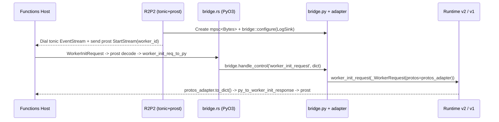

---

#### Phase Compound Topology

---

```mermaid
flowchart LR
  subgraph c315_host["Functions Host (.NET — azure-functions-host)"]
    n315_host["Script Host (WorkerChannel)<br/>(functions-host)"]
  end
  subgraph c315_wire["Wire Contract (worker-protobuf)"]
    n315_proto["FunctionRpc.proto Contract<br/>(worker-protobuf)"]
  end
  subgraph c315_proc["R2P2 Worker Process (Rust Binary + Embedded CPython 3.15)"]
    subgraph c315_rust["Layer 1: Native Rust Shell (workers/r2p2/src)"]
      n315_tonic["Tokio + Tonic EventStream<br/>(python-worker)"]
      n315_router["Prost Router & Status Fast-Path<br/>(python-worker)"]
    end
    subgraph c315_ffi["PyO3 FFI Thin Waist (GIL)"]
      n315_hot_ffi["Hot FFI: bridge::invoke + convert.rs<br/>(python-worker)"]
      n315_ctrl_ffi["Control FFI: bridge::handle + LogSink<br/>(python-worker)"]
    end
    subgraph c315_py["Layer 2: Embedded Python Bridge & Runtime"]
      n315_bridge_py["bridge.py & protos_adapter.py<br/>(python-worker)"]
      n315_native_py["native_invocation.py (v2 & v1)<br/>(python-worker)"]
      n315_rt["Runtime handle_event + http_v2<br/>(python-worker)"]
    end
  end
  subgraph c315_eco["SDK, Extensions & Customer Function App"]
    n315_lib["azure-functions (Datum + Decorators)<br/>(python-library)"]
    n315_ext["extensions (HTTP-v2 FastAPI & SdkType)<br/>(python-extensions)"]
  end
  n315_host -->|"WorkerChannel"| n315_proto
  n315_tonic -->|"1. bridge::configure(LogSink)"| n315_ctrl_ffi
  n315_tonic -->|"2. tonic connect + StartStream (prost)"| n315_proto
  n315_proto -->|"3. WorkerInitRequest bytes"| n315_router
  n315_router -->|"4. worker_init_req_to_py(PyDict)"| n315_ctrl_ffi
  n315_ctrl_ffi -->|"5. handle_control + select v2/v1"| n315_bridge_py
  n315_bridge_py -->|"6. WorkerRequest(protos=protos_adapter)"| n315_rt
  n315_rt -->|"7. V2 indexes @app decorators"| n315_lib
```

---

### 2. Worker Specialization Flow (Namespace-Safe Eviction + Reload)

---

- **Wire Protocol:** `FunctionEnvironmentReloadRequest → _clear_modules_from_path → ReloadResponse`

---

- **Execution Scope:** Linux / Flex Consumption Only (Placeholder Mode)

---

When specializing a warm R2P2 standby process, `bridge.py` runs **`_clear_modules_from_path(_workers_dir)`**: file-backed worker modules & cached descendants are evicted and stale child attributes are detached from retained parents, while **PEP 420 namespace parents (`azure`, `azurefunctions`) without `__file__` are preserved** so customer SDK/extension children stay attached! Plus zero `grpcio`/`protobuf` C-extensions ever existed in `sys.modules` to collide with customer pins.

---

> **Bypassed / Idle Note:** Hot invocation seam is cleared (`_control_path_cache.clear()`) and re-bound to the newly selected runtime.

---

#### Sequence Diagram

---

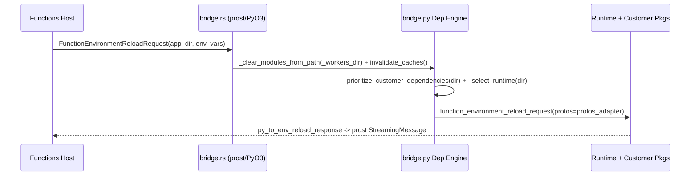

---

#### Phase Compound Topology

---

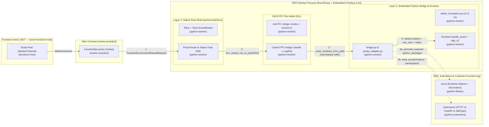

---

### 3. Worker Metadata & Indexing Flow

---

- **Wire Protocol:** `FunctionsMetadataRequest → control.rs → protos_adapter → prost`

---

- **Execution Scope:** V2 Returns Indexed Decorator Metadata; V1 Signals Host Indexing

---

Rust `bridge::handle` decodes `FunctionsMetadataRequest` and calls `bridge.handle_control('functions_metadata_request', {})`. Runtime V2 returns its indexed `RawFunctionMetadata` list wrapped in `protos_adapter` objects (`.to_dict()`), which `control::py_to_function_metadata_response` serializes into native `prost` wire bytes. Runtime V1 returns `use_default_metadata_indexing=True`.

---

> **Bypassed / Idle Note:** Hot native tuple FFI (`bridge::invoke`) is unused during metadata discovery.

---

#### Sequence Diagram

---

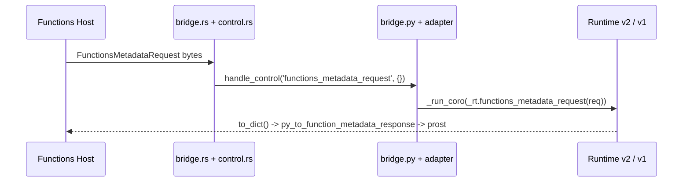

---

#### Phase Compound Topology

---

```mermaid
flowchart LR
  subgraph c315_host["Functions Host (.NET — azure-functions-host)"]
    n315_host["Script Host (WorkerChannel)<br/>(functions-host)"]
  end
  subgraph c315_wire["Wire Contract (worker-protobuf)"]
    n315_proto["FunctionRpc.proto Contract<br/>(worker-protobuf)"]
  end
  subgraph c315_proc["R2P2 Worker Process (Rust Binary + Embedded CPython 3.15)"]
    subgraph c315_rust["Layer 1: Native Rust Shell (workers/r2p2/src)"]
      n315_tonic["Tokio + Tonic EventStream<br/>(python-worker)"]
      n315_router["Prost Router & Status Fast-Path<br/>(python-worker)"]
    end
    subgraph c315_ffi["PyO3 FFI Thin Waist (GIL)"]
      n315_hot_ffi["Hot FFI: bridge::invoke + convert.rs<br/>(python-worker)"]
      n315_ctrl_ffi["Control FFI: bridge::handle + LogSink<br/>(python-worker)"]
    end
    subgraph c315_py["Layer 2: Embedded Python Bridge & Runtime"]
      n315_bridge_py["bridge.py & protos_adapter.py<br/>(python-worker)"]
      n315_native_py["native_invocation.py (v2 & v1)<br/>(python-worker)"]
      n315_rt["Runtime handle_event + http_v2<br/>(python-worker)"]
    end
  end
  subgraph c315_eco["SDK, Extensions & Customer Function App"]
    n315_lib["azure-functions (Datum + Decorators)<br/>(python-library)"]
    n315_ext["extensions (HTTP-v2 FastAPI & SdkType)<br/>(python-extensions)"]
  end
  n315_host -->|"WorkerChannel"| n315_proto
  n315_proto -->|"1. FunctionsMetadataRequest"| n315_router
  n315_router -->|"2. bridge::handle()"| n315_ctrl_ffi
  n315_ctrl_ffi -->|"3. handle_control(dict)"| n315_bridge_py
  n315_bridge_py -->|"4. functions_metadata_request()"| n315_rt
```

---

### 4. Worker Functions Load Flow (V1 `_metadata_ns` Import vs V2 Ack)

---

- **Wire Protocol:** `FunctionLoadRequest → _metadata_ns(SimpleNamespace) → FunctionLoadResponse`

---

- **Execution Scope:** V1 `function.json` Script Loading (`azure_functions_runtime_v1`); V2 Immediate Ack

---

For **V1** apps, `control::function_load_req_to_py` decodes `RpcFunctionMetadata` & `BindingInfo` into a `PyDict`, and `bridge._metadata_ns()` wraps them in `SimpleNamespace` objects matching protobuf attribute access so `azure_functions_runtime_v1` imports `__init__.py` without `google.protobuf`! For **V2** apps, `function_load_request` immediately returns `Success`.

---

> **Bypassed / Idle Note:** Hot FFI stays idle; V2 apps return immediate Success while V1 apps import their `__init__.py` entrypoints here.

---

#### Sequence Diagram

---

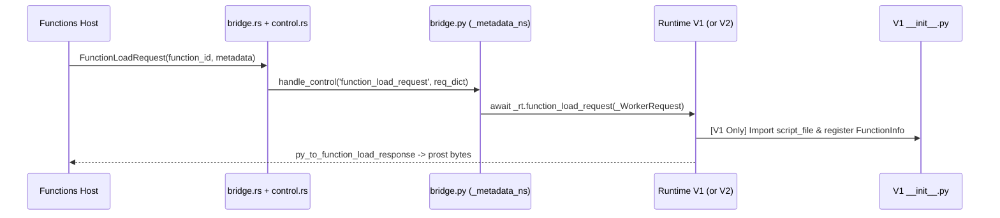

---

#### Phase Compound Topology

---

```mermaid
flowchart LR
  subgraph c315_host["Functions Host (.NET — azure-functions-host)"]
    n315_host["Script Host (WorkerChannel)<br/>(functions-host)"]
  end
  subgraph c315_wire["Wire Contract (worker-protobuf)"]
    n315_proto["FunctionRpc.proto Contract<br/>(worker-protobuf)"]
  end
  subgraph c315_proc["R2P2 Worker Process (Rust Binary + Embedded CPython 3.15)"]
    subgraph c315_rust["Layer 1: Native Rust Shell (workers/r2p2/src)"]
      n315_tonic["Tokio + Tonic EventStream<br/>(python-worker)"]
      n315_router["Prost Router & Status Fast-Path<br/>(python-worker)"]
    end
    subgraph c315_ffi["PyO3 FFI Thin Waist (GIL)"]
      n315_hot_ffi["Hot FFI: bridge::invoke + convert.rs<br/>(python-worker)"]
      n315_ctrl_ffi["Control FFI: bridge::handle + LogSink<br/>(python-worker)"]
    end
    subgraph c315_py["Layer 2: Embedded Python Bridge & Runtime"]
      n315_bridge_py["bridge.py & protos_adapter.py<br/>(python-worker)"]
      n315_native_py["native_invocation.py (v2 & v1)<br/>(python-worker)"]
      n315_rt["Runtime handle_event + http_v2<br/>(python-worker)"]
    end
  end
  subgraph c315_eco["SDK, Extensions & Customer Function App"]
    n315_lib["azure-functions (Datum + Decorators)<br/>(python-library)"]
    n315_ext["extensions (HTTP-v2 FastAPI & SdkType)<br/>(python-extensions)"]
  end
  n315_host -->|"WorkerChannel"| n315_proto
  n315_proto -->|"1. FunctionLoadRequest"| n315_router
  n315_router -->|"2. function_load_req_to_py(dict)"| n315_ctrl_ffi
  n315_ctrl_ffi -->|"3. _metadata_ns + _binding_ns"| n315_bridge_py
  n315_bridge_py -->|"4. V1 load_function() / V2 ack"| n315_rt
  n315_rt -.->|"5. V1 imports __init__.py"| n315_lib
```

---

### 5. Worker Invocation Flow (Dual Path: Native Datum Tuples vs Extensions)

---

- **Wire Protocol:** `InvocationRequest → [Hot: bridge::invoke | Ext: bridge::handle] → InvocationResponse`

---

- **Execution Scope:** Every Trigger Execution (+122% Throughput on Hot Path)

---

`main.rs` spawns a concurrent task per request and checks memoized `needs_control_path(function_id)`: **(A) Hot Path** (standard V2/V1 `python-library` bindings) converts `prost` `TypedData` directly into PyO3 `(tag, val)` datum tuples (`convert.rs`) and calls `native_invocation.py`—zero Python protobuf! **(B) Control Path** (`python-extensions` `http_v2` FastAPI streaming or `SdkType` deferred bindings) routes via `control.rs` `PyDict` + `protos_adapter.py` to `handle_event.py`.

---

> **Bypassed / Idle Note:** Standard functions completely bypass `control.rs`, `protos_adapter.py`, and `handle_event.py`!

---

#### Sequence Diagram

---

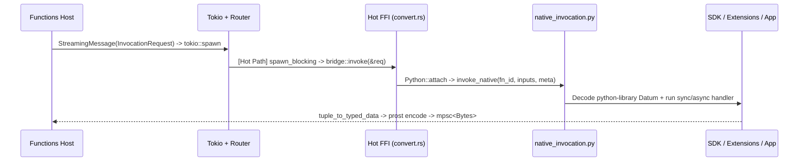

---

#### Phase Compound Topology

---

```mermaid
flowchart LR
  subgraph c315_host["Functions Host (.NET — azure-functions-host)"]
    n315_host["Script Host (WorkerChannel)<br/>(functions-host)"]
  end
  subgraph c315_wire["Wire Contract (worker-protobuf)"]
    n315_proto["FunctionRpc.proto Contract<br/>(worker-protobuf)"]
  end
  subgraph c315_proc["R2P2 Worker Process (Rust Binary + Embedded CPython 3.15)"]
    subgraph c315_rust["Layer 1: Native Rust Shell (workers/r2p2/src)"]
      n315_tonic["Tokio + Tonic EventStream<br/>(python-worker)"]
      n315_router["Prost Router & Status Fast-Path<br/>(python-worker)"]
    end
    subgraph c315_ffi["PyO3 FFI Thin Waist (GIL)"]
      n315_hot_ffi["Hot FFI: bridge::invoke + convert.rs<br/>(python-worker)"]
      n315_ctrl_ffi["Control FFI: bridge::handle + LogSink<br/>(python-worker)"]
    end
    subgraph c315_py["Layer 2: Embedded Python Bridge & Runtime"]
      n315_bridge_py["bridge.py & protos_adapter.py<br/>(python-worker)"]
      n315_native_py["native_invocation.py (v2 & v1)<br/>(python-worker)"]
      n315_rt["Runtime handle_event + http_v2<br/>(python-worker)"]
    end
  end
  subgraph c315_eco["SDK, Extensions & Customer Function App"]
    n315_lib["azure-functions (Datum + Decorators)<br/>(python-library)"]
    n315_ext["extensions (HTTP-v2 FastAPI & SdkType)<br/>(python-extensions)"]
  end
  n315_host -->|"WorkerChannel"| n315_proto
  n315_proto -->|"1. InvocationRequest (BytesCodec)"| n315_tonic
  n315_tonic -->|"2. tokio::spawn + control_path_cache"| n315_router
  n315_router -->|"3a. Hot: bridge::invoke()"| n315_hot_ffi
  n315_hot_ffi -->|"4a. invoke_native(datum tuples)"| n315_native_py
  n315_native_py -->|"5a. Datum decode + sync/async fn"| n315_lib
  n315_router -.->|"3b. Ext: HTTP-v2 / SdkType"| n315_ctrl_ffi
  n315_ctrl_ffi -.->|"4b. handle_invocation_control"| n315_bridge_py
  n315_bridge_py -.->|"5b. handle_event + http_v2"| n315_rt
  n315_rt -.->|"6b. stream WebApp / SdkType"| n315_ext
```

---

### 6. Worker Status Flow (Zero-GIL Native Rust Fast-Path)

---

- **Wire Protocol:** `WorkerStatusRequest → Rust prost → WorkerStatusResponse (0 Python / 0 GIL)`

---

- **Execution Scope:** Host Scale Controller Health Check (Entire CPython Interpreter Bypassed!)

---

Major architectural win in R2P2: when `bridge::handle` (`src/bridge.rs:L114`) matches `Content::WorkerStatusRequest`, it builds `WorkerStatusResponse` in **pure Rust** and pushes the bytes onto `mpsc<Bytes>` **without calling `Python::attach` and without acquiring the GIL**! Even if customer Python threads are 100% CPU-saturated holding the GIL, scale probes answer in microseconds.

---

> **Bypassed / Idle Note:** PyO3 GIL boundary, Bridge, Runtime Engine, SDK, Extensions, and User Code are 100% untouched!

---

#### Sequence Diagram

---

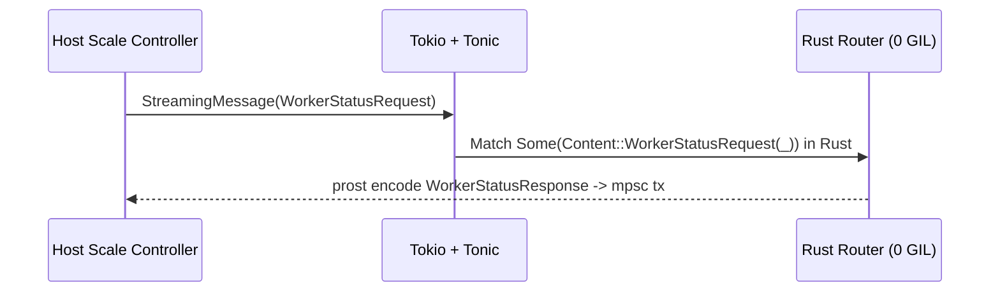

---

#### Phase Compound Topology

---

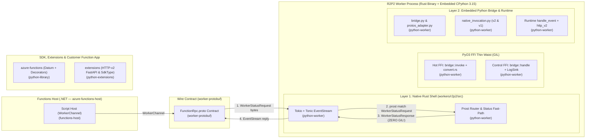

---

### 7. Worker Logs Flow (Non-Blocking PyO3 LogSink → Lock-Free Rust mpsc)

---

- **Wire Protocol:** `logging.LogRecord → _RpcLogHandler → #[pyclass] LogSink → prost → Host`

---

- **Execution Scope:** Reverse Telemetry Stream (Customer & System Logs → Host)

---

Startup logs emit `LanguageWorkerConsoleLog` via `src/log.rs`. Once `bridge.configure()` runs, `_RpcLogHandler` captures all Python root logs, resolves `invocation_id` from **1) `_rt.invocation_id_cv`** (async & threadpool handlers) or **2) `_rt_tls` (`context.thread_local_storage.invocation_id`)** (user-spawned `threading.Thread`s!), and calls `LogSink.emit_log(dict)`. Rust `prost`-encodes `RpcLog` and pushes onto the lock-free `UnboundedSender<Bytes>` without awaiting or deadlocking the GIL.

---

> **Bypassed / Idle Note:** Flows RIGHT → LEFT from User Code / Runtime into PyO3 `LogSink` and straight onto the outbound tonic stream.

---

#### Sequence Diagram

---

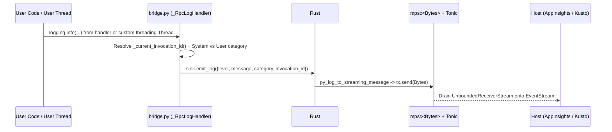

---

#### Phase Compound Topology

---

```mermaid
flowchart LR
  subgraph c315_host["Functions Host (.NET — azure-functions-host)"]
    n315_host["Script Host (WorkerChannel)<br/>(functions-host)"]
  end
  subgraph c315_wire["Wire Contract (worker-protobuf)"]
    n315_proto["FunctionRpc.proto Contract<br/>(worker-protobuf)"]
  end
  subgraph c315_proc["R2P2 Worker Process (Rust Binary + Embedded CPython 3.15)"]
    subgraph c315_rust["Layer 1: Native Rust Shell (workers/r2p2/src)"]
      n315_tonic["Tokio + Tonic EventStream<br/>(python-worker)"]
      n315_router["Prost Router & Status Fast-Path<br/>(python-worker)"]
    end
    subgraph c315_ffi["PyO3 FFI Thin Waist (GIL)"]
      n315_hot_ffi["Hot FFI: bridge::invoke + convert.rs<br/>(python-worker)"]
      n315_ctrl_ffi["Control FFI: bridge::handle + LogSink<br/>(python-worker)"]
    end
    subgraph c315_py["Layer 2: Embedded Python Bridge & Runtime"]
      n315_bridge_py["bridge.py & protos_adapter.py<br/>(python-worker)"]
      n315_native_py["native_invocation.py (v2 & v1)<br/>(python-worker)"]
      n315_rt["Runtime handle_event + http_v2<br/>(python-worker)"]
    end
  end
  subgraph c315_eco["SDK, Extensions & Customer Function App"]
    n315_lib["azure-functions (Datum + Decorators)<br/>(python-library)"]
    n315_ext["extensions (HTTP-v2 FastAPI & SdkType)<br/>(python-extensions)"]
  end
  n315_proto -->|"AppInsights / Kusto"| n315_host
  n315_lib -->|"1. user logging.info() (cv / _rt_tls)"| n315_native_py
  n315_native_py -->|"2. _RpcLogHandler + _current_invocation_id()"| n315_bridge_py
  n315_bridge_py -->|"3. LogSink.emit_log(flat dict)"| n315_ctrl_ffi
  n315_ctrl_ffi -->|"4. prost encode -> UnboundedSender<Bytes>"| n315_tonic
  n315_tonic -->|"5. StreamingMessage(RpcLog) → Host"| n315_proto
```

<!-- END AUTO-GENERATED: py315_r2p2-phases -->
